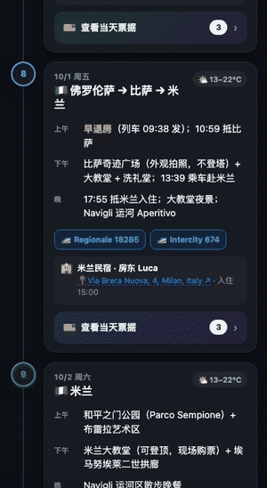
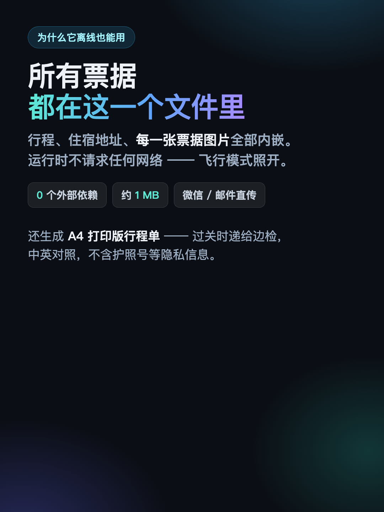
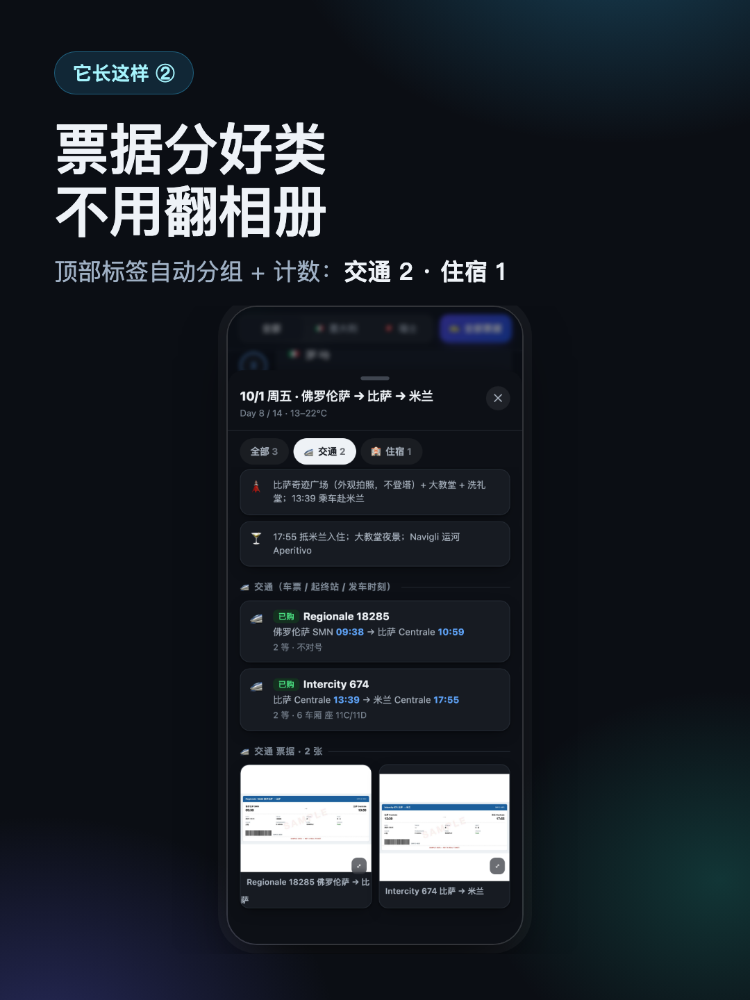
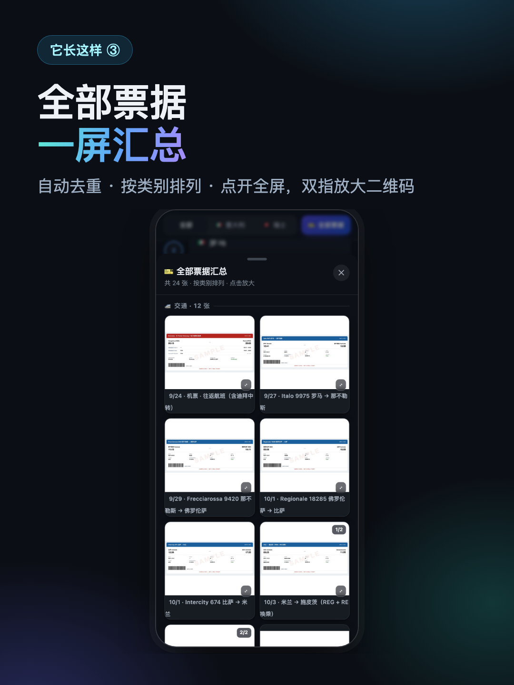

<div align="center">


# travel-plan-kit · 自制离线路书

**Turn one `trip.yaml` into a printable itinerary + a mobile roadbook that
works with no signal.** 国外旅游超好用。

[](LICENSE)


<br/>



<sub><b>点任意一天 → 票据抽屉 → 全屏车票</b> · 真机录制，非效果图</sub>

</div>

---

## 📴 信号再差也能用 · Works with no signal

> 路书是**一个自包含的 HTML 文件**——行程、住宿地址、**每一张票据图片**全部嵌在文件内部，
> 运行时不发起任何网络请求。
>
> 地铁里、火车隧道里、阿尔卑斯山谷里、飞机上，**断网照常打开**。
>
> 出境游最怕的就是这个：瑞士山区的火车上、去卡普里的渡轮上、博物馆排队时想确认门票时间，
> 信号说没就没。把这一份文件 AirDrop 到手机里，用不着流量、用不着 Wi-Fi、也刷不出"页面无法打开"。

The roadbook is one self-contained HTML file. The itinerary, the lodging and
**every ticket image** are embedded inside it, and the build asserts zero
external references. On a plane, in a tunnel, in an alpine valley, it opens
anyway.

That constraint also explains the encrypted variant below: it needs a network
fetch, so it is the *backup* for when you have signal — not the thing you rely
on when you don't.

<p align="center">
  
</p>

## 🧭 The roadbook（路书）

One HTML file — no server, no app, no network. AirDrop it to a phone and it
works anywhere. Built to be used one-handed, standing up, in a hurry:

- **Tap any day** → a bottom-sheet drawer slides up with everything for that
  day: the schedule, the transport legs with train numbers and seat
  assignments, where you're sleeping, and the tickets themselves. Swipe down
  to dismiss it.
- **Tickets are grouped and counted** — `全部 3 · 🚄 交通 2 · 🏨 住宿 1`. At a
  ticket gate you want the train ticket, not a scroll through your camera roll.
- **Tap a ticket** → full-screen. Pinch to zoom into a QR code, swipe between
  tickets, long-press to save to your photo library.
- **🎫 全部票据** → every ticket in the whole trip in one place, grouped by
  category and de-duplicated (a rail pass used on three days appears once).
- **Addresses are Google Maps links.** Every stay shows one, and the drawer has
  a full-width "🧭 在 Google 地图中打开" button — the thing you actually want
  when you're standing on a street corner at 22:00.
- **Filter by country** to collapse a 14-day trip down to one leg.
- **Live countdown** — `D-12` before you leave, `Day 3` while you're away, and
  the current day's card is highlighted with a "今天" badge.
- **Follows your phone's light/dark setting.**

<table>
  <tr>
    <td align="center" width="33%">
      <br/>
      <sub><b>按天时间轴</b> · 点任意一天，当天行程 / 交通 / 住宿 / 票据一起弹出</sub>
    </td>
    <td align="center" width="33%">
      <br/>
      <sub><b>票据自动分类</b> · 标签带计数，闸机前直接翻到车票</sub>
    </td>
    <td align="center" width="33%">
      <br/>
      <sub><b>全部票据汇总</b> · 自动去重，点开全屏、双指放大二维码</sub>
    </td>
  </tr>
</table>

### One more thing about offline

Print the PDF before you leave, and keep the roadbook on the phone. They fail
differently: paper survives a dead battery, and the roadbook survives a lost
printout.

## 😮‍💨 Why this exists

It started as a real two-week Italy → Switzerland trip. Every booking lived in
a different app, every ticket was another screenshot buried in the camera roll,
and the moment the signal dropped, none of it was reachable. So the whole trip
got compiled into one page — and that page got used daily on trains, in alpine
valleys, and at museum turnstiles. This repo is that tooling, generalised.

<p align="center">
  
</p>

## 🖨 What else you get

| Output | What it's for |
|---|---|
| `itinerary.md` | the master table, plain Markdown — readable anywhere, diffable |
| `itinerary.html` | the same table, styled for print |
| `itinerary.pdf` | landscape A4 — print one per traveller; border officers sometimes question people separately |
| `roadbook.html` | the offline roadbook above |
| `roadbook.enc.html` | optional password-encrypted roadbook, safe to host publicly |

<p align="center">
  
</p>

## 🚀 Quick start

```bash
git clone https://github.com/Xxxxxzh1/travel-plan-kit ~/.claude/skills/travel-plan-kit
cd ~/.claude/skills/travel-plan-kit

pip install pyyaml            # the only required dependency
python3 scripts/build.py examples/italy-switzerland/trip.yaml
open examples/italy-switzerland/out/roadbook.html
```

Then copy `trip.example.yaml`, fill in your own trip, and run `build.py` on it.

<p align="center">
  
</p>

## 🧬 Why the formats stay consistent

Every output renders from the same data, so they cannot disagree with each
other. Two rules enforce that:

**A stay is declared once.** `lodging` is a top-level list; a day references it
by `id`. A stay that spans three nights is stored once and looked up three
times, so correcting an address is one edit rather than three.

```yaml
lodging:
  - id: rome
    city: 罗马
    address: Via dei Fiori, 12, Rome, Italy
    checkin:  {date: 2027-09-24, time: "16:00"}
    checkout: {date: 2027-09-27, time: "10:00"}
    nights: 3

days:
  - {n: 1, date: 2027-09-24, city: 罗马, lodging: rome}
```

**The Markdown and the HTML render from one row builder.** They pass a format
flag that changes only how inline markup becomes text — never the structure. Two
hand-maintained copies of the same table drift apart eventually; one builder
cannot drift from itself.

**And the build validates before it generates.** `nights` is checked against the
dates. A day pointing at a lodging id that doesn't exist is an error. So is a
ticket id with no file behind it, and a date out of order. You get every problem
at once, with its location:

```
trip file has problems:
  - days[3]: lodging 'nowhere' is not defined in the lodging list
  - lodging[0]: nights=4 but 2027-09-24..2027-09-27 is 3 night(s)
  - tickets[6]: file not found: tickets/shinkansen.pdf
```

## 📦 Requirements

- **Python 3** + `pyyaml` — required
- **Chrome / Chromium / Edge / Brave** — for PDF and ticket rendering. No
  wkhtmltopdf, weasyprint or pandoc needed (and they handle the CSS here worse).
  Override with `CHROME=/path/to/chrome`.
- **`pdftoppm`** (poppler) — only if your tickets are PDFs.
  `brew install poppler` / `apt install poppler-utils`
- **Pillow** — optional; keeps the roadbook small by downscaling ticket images
- **Node.js** — only for `--encrypt`

`build.py` checks all of this up front and tells you exactly what's missing.

## 🔐 Hosting the encrypted roadbook

The roadbook contains live ticket QR codes, so think before putting it online.

**GitHub Pages sites are always public on free and Pro plans.** Publishing a
Pages site *privately* requires GitHub Enterprise Cloud — a private repository
does not give you a private site.

So `--encrypt` encrypts the entire payload (itinerary, lodging, and every ticket
image) with **AES-256-GCM** under a key derived by PBKDF2 from your password,
gzip-compressed first so the base64 framing isn't paid twice:

```bash
python3 scripts/build.py my-trip.yaml --encrypt 'correct horse battery staple'
```

The result is inert without the password, so it is safe even in a public repo.
A JavaScript "enter password" overlay would not be — the tickets would still be
sitting in the file in clear.

⚠️ **Encryption strength equals password strength.** The 400,000 PBKDF2
iterations make each guess cost something, but `holiday` is still a dictionary
word. Use a passphrase.

⚠️ **And it trades away offline access.** An encrypted roadbook needs a network
connection to fetch the file. The unencrypted one you AirDropped works on a
plane. For most trips you want both.

## 🤖 Using it as a Claude Code skill

Clone into `~/.claude/skills/` as shown above and Claude picks it up. Ask for a
"travel itinerary", "路书", or "行程单" and it will gather your trip, write the
`trip.yaml`, validate it, and build the documents. `SKILL.md` documents the
workflow; `references/` has the detail.

## 🗂 Repo layout

```
SKILL.md                      Claude Code skill entry
trip.example.yaml             minimal commented template
schema/trip.schema.json       schema for editor autocomplete
scripts/
  model.py                    parse + validate + resolve id references
  build.py                    orchestrator
  gen_itinerary.py            → md, html
  gen_roadbook.py             → mobile roadbook
  ingest_tickets.py           normalise ticket images
  make_sample_tickets.py      generate synthetic tickets for the example
  encrypt_roadbook.mjs        AES-256-GCM password gate
  browser.py                  locate and drive headless Chrome
  record_demo.mjs             capture the README's demo GIF frames
  make_demo_gif.py            assemble those frames into the GIF
templates/                    tokens.css, itinerary.html, roadbook.html
references/                   data model, pipeline, ticket handling
examples/italy-switzerland/   complete worked example
docs/promo/                   the promo cards used above
docs/screenshots/             demo GIF + printed-PDF shot
```

The demo GIF is regenerated by recording the built example:

```bash
cd examples/italy-switzerland/out && python3 -m http.server 8770 --bind 127.0.0.1 &
node scripts/record_demo.mjs http://localhost:8770/roadbook.html /tmp/frames
python3 scripts/make_demo_gif.py /tmp/frames docs/screenshots/roadbook-demo.gif
```

The recorder sets an exact 390×844 phone viewport through CDP device metrics —
`--window-size` gets clamped by headless Chrome and silently crops the frames —
and stretches the drawer's CSS transition, because a 360 ms slide is shorter
than a CDP screenshot round-trip and would otherwise never be captured mid-motion.

## 🎭 About the example data

The example trip is **entirely synthetic**. Names, host names, street addresses,
phone numbers and booking references are invented; the ticket images are
generated by `scripts/make_sample_tickets.py` and stamped
`SAMPLE DATA — NOT A REAL TICKET`. The route is real geography and nothing else
is real.

That is deliberate. Real ticket images carry names, dates of birth, booking
references and QR codes that are themselves the credential — they do not belong
in a public repository. Keep your own generated output out of version control.

## Licence

MIT
