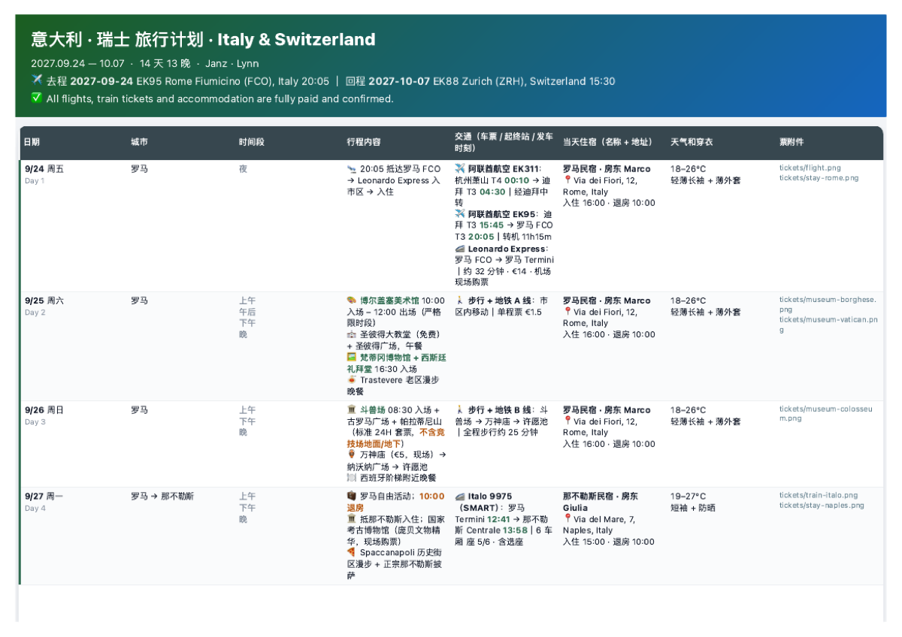

# travel-plan-kit

Turn **one `trip.yaml`** into a complete set of travel documents — a Markdown
table, a print-ready PDF, and a mobile **roadbook**: a single self-contained
HTML file with every ticket embedded, that opens on your phone with no signal.

Built for a two-week Italy/Switzerland trip where the roadbook got used daily on
trains, in alpine valleys, and at museum turnstiles.

<p align="center">
  
  
</p>
<p align="center">
  
</p>

## What you get

| Output | What it's for |
|---|---|
| `itinerary.md` | the master table, plain Markdown — readable anywhere, diffable |
| `itinerary.html` | the same table, styled for print |
| `itinerary.pdf` | landscape A4 — print one per traveller; border officers sometimes question people separately |
| `roadbook.html` | **the one that matters in the field.** Mobile layout, ticket drawer, lightbox, Google Maps links, works offline |
| `roadbook.enc.html` | optional password-encrypted roadbook, safe to host publicly |

## Quick start

```bash
git clone https://github.com/Janz/travel-plan-kit ~/.claude/skills/travel-plan-kit
cd ~/.claude/skills/travel-plan-kit

pip install pyyaml            # the only required dependency
python3 scripts/build.py examples/italy-switzerland/trip.yaml
open examples/italy-switzerland/out/roadbook.html
```

Then copy `trip.example.yaml`, fill in your own trip, and run `build.py` on it.

## The idea

Every format renders from the same data, so they cannot disagree.

That sounds obvious, but the version this tool replaced got it wrong. The
Markdown itinerary and the HTML itinerary were separate hand-edited copies of
the same table. They drifted — and months after the museum tickets had been
bought, one of the two still said the museum was unbooked. If you have ever
maintained a trip in four formats at once, you have met this bug.

Two rules keep it from coming back:

**A stay is declared once.** `lodging` is a top-level list; a day references it
by `id`. A three-night stay used to exist in three places, so correcting an
address meant editing three copies.

```yaml
lodging:
  - id: rome
    city: 罗马
    address: Via dei Fiori, 12, Rome, Italy
    checkin:  {date: 2027-09-24, time: "16:00"}
    checkout: {date: 2027-09-27, time: "10:00"}
    nights: 3

days:
  - {n: 1, date: 2027-09-24, city: 罗马, lodging: rome}
```

**The build validates before it generates.** `nights` is checked against the
dates. A day pointing at a lodging id that doesn't exist is an error. So is a
ticket id with no file behind it, and a date out of order. You get every problem
at once, with its location:

```
trip file has problems:
  - days[3]: lodging 'nowhere' is not defined in the lodging list
  - lodging[0]: nights=4 but 2027-09-24..2027-09-27 is 3 night(s)
```

## Requirements

- **Python 3** + `pyyaml` — required
- **Chrome / Chromium / Edge / Brave** — for PDF and ticket rendering. No
  wkhtmltopdf, weasyprint or pandoc needed (and they handle the CSS here worse).
  Override with `CHROME=/path/to/chrome`.
- **`pdftoppm`** (poppler) — only if your tickets are PDFs.
  `brew install poppler` / `apt install poppler-utils`
- **Pillow** — optional; keeps the roadbook small by downscaling ticket images
- **Node.js** — only for `--encrypt`

`build.py` checks all of this up front and tells you exactly what's missing.

## Hosting the encrypted roadbook

The roadbook contains live ticket QR codes, so think before putting it online.

**GitHub Pages sites are always public on free and Pro plans.** Publishing a
Pages site *privately* requires GitHub Enterprise Cloud — a private repository
does not give you a private site.

So `--encrypt` encrypts the entire payload (itinerary, lodging, and every ticket
image) with **AES-256-GCM** under a key derived by PBKDF2 from your password,
gzip-compressed first so the base64 framing isn't paid twice:

```bash
python3 scripts/build.py my-trip.yaml --encrypt 'correct horse battery staple'
```

The result is inert without the password, so it is safe even in a public repo.
A JavaScript "enter password" overlay would not be — the tickets would still be
sitting in the file in clear.

⚠️ **Encryption strength equals password strength.** The 400,000 PBKDF2
iterations make each guess cost something, but `holiday` is still a dictionary
word. Use a passphrase.

⚠️ **And it trades away offline access.** An encrypted roadbook needs a network
connection to fetch the file. The unencrypted one you AirDropped works on a
plane. For most trips you want both.

## Using it as a Claude Code skill

Clone into `~/.claude/skills/` as shown above and Claude picks it up. Ask for a
"travel itinerary", "路书", or "行程单" and it will gather your trip, write the
`trip.yaml`, validate it, and build the documents. `SKILL.md` documents the
workflow; `references/` has the detail.

## Repo layout

```
SKILL.md                      Claude Code skill entry
trip.example.yaml             minimal commented template
schema/trip.schema.json       schema for editor autocomplete
scripts/
  model.py                    parse + validate + resolve id references
  build.py                    orchestrator
  gen_itinerary.py            → md, html
  gen_roadbook.py             → mobile roadbook
  ingest_tickets.py           normalise ticket images
  make_sample_tickets.py      generate synthetic tickets for the example
  encrypt_roadbook.mjs        AES-256-GCM password gate
  browser.py                  locate and drive headless Chrome
templates/                    tokens.css, itinerary.html, roadbook.html
references/                   data model, pipeline, ticket handling
examples/italy-switzerland/   complete worked example
docs/screenshots/             images used above
```

## About the example data

The example trip is **entirely synthetic**. Names, host names, street addresses,
phone numbers and booking references are invented; the ticket images are
generated by `scripts/make_sample_tickets.py` and stamped
`SAMPLE DATA — NOT A REAL TICKET`. The route is real geography and nothing else
is real.

That is deliberate. Real ticket images carry names, dates of birth, booking
references and QR codes that are themselves the credential — they do not belong
in a public repository. Keep your own generated output out of version control.

## Licence

MIT
